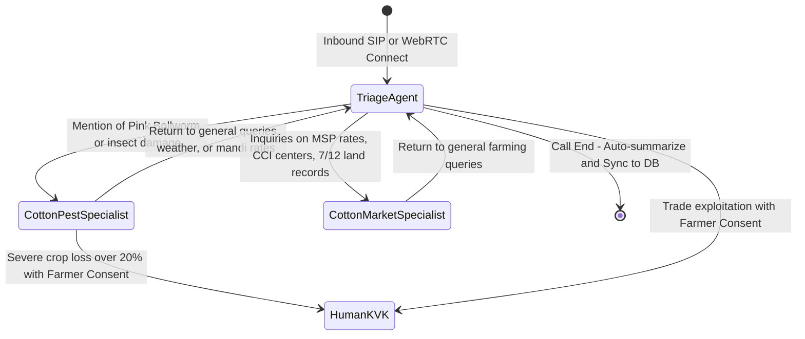

# Krushi Mitra (कृषी मित्र)
### Enterprise Real-Time Multilingual Voice AI for Rural Agriculture

[](https://docs.livekit.io/agents)
[](https://murf.ai/api/docs/text-to-speech-models/falcon-2)
[](https://console.groq.com)
[](https://developers.deepgram.com)
[](https://www.python.org/)
[](https://nextjs.org/)
[](./backend/tests)
[](https://opensource.org/licenses/MIT)

**Krushi Mitra** is a production-grade, ultra-low-latency multilingual Voice AI assistant engineered to empower smallholder cotton and cash-crop farmers across the Vidarbha region of Maharashtra, India (covering Yavatmal, Amravati, Akola, and Wardha).

Unlike standard text chatbots or rigid IVR phone trees, Krushi Mitra operates as a natural conversational partner over both **PSTN telephone lines (via SIP trunking)** and **WebRTC browser sessions**. Delivering an end-to-end turnaround latency under **600 milliseconds**, the system understands and speaks colloquial Marathi, retrieves real-time root-zone soil telemetry, calculates daily evapotranspiration crop deficits, monitors multi-commodity APMC mandi rates against government Minimum Support Prices (MSP), coordinates multi-agent domain handoffs, and strictly enforces agricultural safety and farmer distress guardrails.

---

## Technical Highlights

- **Sub-600ms Time-to-First-Audio (TTFA)**: Combines pre-warmed Silero VAD (0.6 activation threshold), LiveKit multilingual turn detection (300ms dynamic endpointing), Groq (`openai/gpt-oss-20b`) / Gemini 3 series preemptive token streaming, and Murf Falcon 2 GEN2 single-sentence tokenization (`min_sentence_len=1`).
- **Audio-First Spoken Marathi & Full-Duplex Dialogue**: Generates phonetically spelled Marathi numbers and currencies (*"सात हजार पाचशे रुपये प्रति क्विंटल"* instead of raw symbols `₹7,500`), incorporates regional conversational markers (*"होय"*, *"समजलं"*, *"एकच मिनिट तपासतो"*), and supports instantaneous barge-in interruption recovery.
- **Multi-Agent Specialist Orchestration**: Context-preserving dynamic routing between the **Triage Generalist**, **Cotton Pest Specialist** (Integrated Pest Management backed by verified government remedies), and **Cotton Market Specialist** (APMC rates, MSP benchmarks, and CCI procurement documentation).
- **Live Real-Time Agricultural Telemetry**:
  - **Open-Meteo Agricultural API**: Hourly root-zone volumetric soil moisture ($0\text{--}1\text{ cm}$) and FAO-56 Penman-Monteith daily reference evapotranspiration ($\text{ET}_0$) for scientific irrigation timing.
  - **Multi-Commodity Mandi Rates**: Live market prices across Vidarbha APMCs for **Cotton (कापूस)**, **Soybean (सोयाबीन)**, and **Tur Dal (तूर डाळ)** with price-deficit alerts.
  - **Severe Weather Alerts**: Automated detection of severe precipitation ($>70\%$), high winds ($>35\text{ km/h}$), and extreme heatwaves ($>42^\circ\text{C}$).
- **High-Performance In-Memory Caching**: Zero-dependency, thread-safe asynchronous TTL cache (`AsyncTTLCache`, 30-min window) delivering sub-millisecond responses on repeated queries and eliminating external API rate-limiting.
- **Telephony Acoustic Conditioning**: Narrow-band `BVCTelephony()` noise suppression tuned for 8kHz PSTN phone lines, actively isolating speech while filtering tractor rumble, pump-set motors, and ambient rural wind noise.
- **Safety & DPDPA Ethical Guardrails**:
  - **Distress Crisis Protocol**: Immediate cessation of agricultural advice and verbal recitation of the National Kisan Suicide / Tele-MANAS Helpline (`1800-599-0019`) upon detecting emotional crisis.
  - **Vendor Neutrality**: Strict ban on private commercial pesticide brand names; recommends only CIB-approved generic active ingredients.
  - **Privacy & Consent**: Blocks storage of financial credentials (Aadhaar, OTP, Bank Accounts) and enforces verbal consent before persisting farmer profiles.
- **Resilient Dual-Persistence**: Asynchronous connection layer supporting cloud-managed Supabase PostgreSQL with transparent fallback to local SQLite (`krushi_mitra.db`).
- **Spec-Driven Engineering**: Fully specified and validated under the **OpenSpec** framework (`spec-driven` schema).

---

## Architecture

The system decouples audio transport, acoustic detection, language inference, domain tools, and speech synthesis into a modular, non-blocking pipeline:

```mermaid
flowchart TD
    subgraph Ingress["1. Telephony and WebRTC Transport"]
        A1["Farmer Mobile (PSTN / 2G / 4G)"] -->|Carrier SIP Trunk| B1["LiveKit SIP Server (DID / Inbound Dispatch)"]
        A2["Web Browser / PWA"] -->|WebRTC Opus Audio| B2["LiveKit Room SFU"]
    end

    subgraph AudioEngine["2. Acoustic Preprocessing and Turn Engine"]
        B1 --> C1["BVCTelephony Noise Canceller (8kHz Narrowband)"]
        B2 --> C2["BVC Standard Noise Canceller (Wideband)"]
        C1 --> D["Silero VAD (activation=0.6, min_speech=100ms)"]
        C2 --> D
        D --> E["MultilingualModel Turn Detector (min_delay=300ms)"]
    end

    subgraph Intelligence["3. Intelligence and Tool Orchestration"]
        E -->|Streaming PCM Audio| F["STT: Deepgram Nova-3 (Sub-250ms) / Whisper-1"]
        F -->|Streamed Tokens + Preemptive Gen| G["LLM: Groq (openai/gpt-oss-20b) / Gemini 3 Series"]
        
        G -->|Async Tool Calls| H["Tool Ecosystem and Async TTL Cache"]
        H --> G
        H --> I1["Open-Meteo Soil and ET0 API (FAO-56)"]
        H --> I2["Open-Meteo 3-Day Weather API"]
        H --> I3["Agmarknet APMC Mandi Dataset (Cotton/Soy/Tur)"]
        H --> I4["KVK Human Escalation Engine"]
        H --> I5["Local RAG: CIB Verified Pest DB"]
        
        G -->|Sentence Token Chunk (min_len=1)| J["TTS: Murf Falcon 2 GEN2 (Marathi mr-IN-shilpa)"]
        J -->|Streamed 24kHz Opus Audio| K["Full-Duplex Audio Playback (sub-600ms e2e)"]
    end

    subgraph Persistence["4. State and Observability"]
        L["Dual Persistence: Supabase Cloud PostgreSQL + Local SQLite"]
        M["Metrics Tracker and /healthz Probe (TTFT, TTFA, Stage Latencies)"]
    end

    G -. Save Fact / Session Summary .-> L
    D -. VAD Latency .-> M
    G -. TTFT Latency .-> M
    J -. TTFA Latency .-> M
```

---

## Latency Engineering Budget

Traditional cloud voice bots suffer from 2,500ms to 4,000ms of dead air, making phone calls feel broken. Krushi Mitra enforces an aggressive latency budget to achieve immediate, natural conversational cadence:

| Pipeline Stage | Naive Voice Agent | Krushi Mitra Optimization | Krushi Mitra Latency |
| :--- | :--- | :--- | :---: |
| **Silence / VAD Endpointing** | 800ms – 1,000ms fixed timer | `MultilingualModel(min_endpointing_delay=0.30s)` + Silero VAD | **300 ms** |
| **Turn Overlap (Savings)** | Sequential execution (0ms) | **Preemptive Generation**: LLM starts on tentative speech boundary | **-150 ms** |
| **Speech-to-Text (STT)** | 600ms batch HTTP upload | Deepgram Nova-3 continuous streaming | **~150 ms** |
| **LLM Inference (TTFT)** | 700ms – 1,200ms cloud inference | Groq LPU (`openai/gpt-oss-20b`) / Gemini 3.5 Flash-Lite | **~160 ms** |
| **TTS Chunk Generation** | 600ms full-sentence buffer | Murf Falcon 2 GEN2 streaming (`min_sentence_len=1`) | **~120 ms** |
| **Transport & Audio Decoding** | 100ms HTTP polling | LiveKit WebRTC / SIP UDP audio frame streaming | **~40 ms** |
| **Total Turnaround Time** | **~3,500 ms (Unnatural)** | **End-to-End Time-to-First-Audio (TTFA)** | **~580 – 620 ms** |

---

## Multi-Agent Domain Architecture

To eliminate prompt bloat and prevent instruction dilution, the system organizes responsibilities across specialized sub-agents:



1. **Krushi Mitra (Triage Agent)**: Handles caller greeting, returning farmer memory injection, live soil moisture analysis, multi-commodity mandi pricing, and severe weather warnings.
2. **Cotton Pest Specialist (`CottonPestSpecialist`)**: Focused on Integrated Pest Management (IPM), pheromone traps, light traps, and economic threshold levels (ETL). Queries local verified government pest remedies via asynchronous RAG.
3. **Cotton Market Specialist (`CottonMarketSpecialist`)**: Focuses on Cotton Corporation of India (CCI) center selling procedures, 7/12 (*सातबारा*) land records, Aadhaar/bank documents, and moisture discount bands ($8\%\text{--}12\%$).
4. **Context Preservation**: Active sessions transfer `chat_ctx.copy()` across agents so farmers never experience disjointed handoffs or repeat themselves.

---

## Repository Structure

```
.
├── backend/                             # Python voice agent service (LiveKit + Murf Falcon)
│   ├── src/
│   │   ├── agent.py                     # Main voice pipeline entrypoint & KrushiMitra agent
│   │   ├── cache.py                     # AsyncTTLCache in-memory telemetry caching layer
│   │   ├── database.py                  # Dual persistence (Supabase PostgreSQL + SQLite)
│   │   ├── logger.py                    # Stage latency logging & TurnLatency dataclass
│   │   ├── metrics.py                   # Production metrics collector & /healthz probe
│   │   ├── prompts.py                   # System prompts & audio-first phonetic guidelines
│   │   ├── rag_utility.py               # Asynchronous RAG query for CIB pest recommendations
│   │   ├── mandi_prices.json            # Mandi dataset for Cotton, Soybean, and Tur Dal
│   │   └── telephony/                   # Carrier phone-call agents
│   │       ├── inbound/                 # Answers incoming SIP phone calls
│   │       └── outbound/                # Automated campaign alert dialer
│   ├── tests/                           # Test suite (72 unit & performance tests)
│   │   ├── test_agent.py                # LLM-as-a-judge evaluators
│   │   ├── test_tools.py                # Agricultural tool execution & cache tests
│   │   └── test_performance.py         # Async DB, RAG, and latency tracker tests
│   ├── pyproject.toml                   # Python dependencies managed via uv
│   └── Dockerfile                       # Multi-stage production container build
├── frontend/                            # Next.js 14 WebRTC frontend application
│   ├── app/                             # Pages, layouts, and LiveKit token route
│   ├── components/                      # Agents UI, voice visualizers, and modals
│   ├── app-config.ts                    # Branding, color accents, and voice visualizer config
│   └── package.json                     # Node.js dependencies managed via pnpm
├── openspec/                            # OpenSpec specification governance & proposals
│   └── changes/voice-agent-improvements/# Validated spec proposal, delta specs, and tasks
├── start_app.ps1                        # Monorepo development runner (Windows PowerShell)
├── start_app.sh                         # Monorepo development runner (Linux/macOS)
└── README.md                            # Project showcase documentation
```

---

## Getting Started

### Prerequisites

- **Python**: 3.10+ (managed with [`uv`](https://docs.astral.sh/uv/))
- **Node.js**: 18+ (managed with [`pnpm`](https://pnpm.io/))
- **LiveKit Cloud** account (or local LiveKit Server)
- API Keys: Murf Falcon (`MURF_API_KEY`), Groq (`GROQ_API_KEY`), Deepgram (`DEEPGRAM_API_KEY`), LiveKit (`LIVEKIT_URL`, `LIVEKIT_API_KEY`, `LIVEKIT_API_SECRET`).

---

### Step 1: Clone the Repository

```bash
git clone https://github.com/Saumojit30/Krushi-Mitra.git
cd Krushi-Mitra
```

---

### Step 2: Configure Environment Variables

Create `.env.local` in `backend/`:

```env
# LiveKit Cloud
LIVEKIT_URL=wss://your-project.livekit.cloud
LIVEKIT_API_KEY=your_livekit_api_key
LIVEKIT_API_SECRET=your_livekit_api_secret

# AI Models & Audio Providers
MURF_API_KEY=your_murf_falcon_api_key
MURF_VOICE_ID=mr-IN-shilpa
DEEPGRAM_API_KEY=your_deepgram_api_key
STT_PROVIDER=deepgram

# LLM Provider Configuration ("groq" or "gemini")
LLM_PROVIDER=groq
GROQ_API_KEY=your_groq_api_key
GROQ_MODEL=openai/gpt-oss-20b

# Alternative: Google Gemini 3 Series
GOOGLE_API_KEY=your_gemini_api_key
GEMINI_MODEL=gemini-3.5-flash-lite

# Optional Database & Telephony Persistence
# SUPABASE_URL=https://your-project.supabase.co
# SUPABASE_KEY=your_supabase_service_key
# LIVEKIT_SIP_OUTBOUND_TRUNK_ID=ST_xxx
# TRANSFER_TO_NUMBER=+91xxxxxxxxxx
```

Create `.env.local` in `frontend/`:

```env
LIVEKIT_URL=wss://your-project.livekit.cloud
LIVEKIT_API_KEY=your_livekit_api_key
LIVEKIT_API_SECRET=your_livekit_api_secret
AGENT_NAME=krushi-mitra
```

---

### Step 3: Install & Start Services

#### Option A: One-Command Startup

```bash
# Windows
.\start_app.ps1

# Linux / macOS
chmod +x start_app.sh
./start_app.sh
```

#### Option B: Individual Services

```bash
# Terminal 1 — Backend Agent
cd backend
uv sync
uv run python src/agent.py download-files
uv run python src/agent.py dev

# Terminal 2 — Frontend UI
cd frontend
pnpm install
pnpm dev
```

Open **`http://localhost:3000`** in your browser. Click **कॉल सुरू करा (Start Call)** to begin a live voice session.

---

## Telephony Setup (SIP Inbound & Outbound)

Krushi Mitra can be reached from standard mobile and feature phones over the Indian telephone network.

1. **Obtain an Indian DID Phone Number** from a SIP carrier (Twilio, Tata Tele, Exotel).
2. **Deploy an Inbound SIP Trunk** using the provided template:
   ```bash
   cd backend
   lk sip inbound create telephony/inbound/inbound-trunk.json
   ```
3. **Deploy the Inbound Dispatch Rule**:
   ```bash
   lk sip dispatch-rule create telephony/inbound/inbound-dispatch.json
   ```
4. **Launch the Telephony Inbound Worker**:
   ```bash
   uv run python src/telephony/inbound/agent.py dev
   ```

---

## Verification & Testing

The backend includes a comprehensive automated test suite verifying tool resilience, async performance, multi-agent handoffs, and LLM guardrails:

```bash
cd backend

# Run the complete test suite (72 unit and performance tests)
uv run pytest -m "not integration" -v

# Run agricultural tools and caching tests
uv run pytest tests/test_tools.py -v

# Run performance and latency tracker tests
uv run pytest tests/test_performance.py -v

# Run code style & linting checks
uv run ruff check .
uv run ruff format --check .

# Validate OpenSpec specifications
openspec validate voice-agent-improvements
```

---

## Ethical & Safety Guardrails

| Risk Scenario | System Defense & Behavior |
| :--- | :--- |
| **Farmer Suicidal Distress** | Voice pipeline halts farming advice immediately; speaks the Kisan Suicide / Tele-MANAS helpline (`1800-599-0019`) clearly and compassionately. |
| **Commercial Brand Steering** | Strict rejection of private chemical pesticide brands (e.g., Bayer, Syngenta, Tata); restricts advice to CIB-verified active ingredients and KVK escalation. |
| **PII & Financial Security** | Interrupts and rejects input containing Aadhaar numbers, bank account details, or OTPs; never stores financial credentials. |
| **Profile Memory Consent** | Requires explicit verbal farmer consent (*"मी ही माहिती पुढच्या वेळसाठी लक्षात ठेवू का?"*) before saving crop or farm acreage facts. |
| **Market Exploitation** | Compares local trader bids against official Government MSP rates (e.g. ₹6,620/qtl for cotton) and guides farmers to CCI procurement centers. |

---

## License

This project is licensed under the [MIT License](LICENSE).
